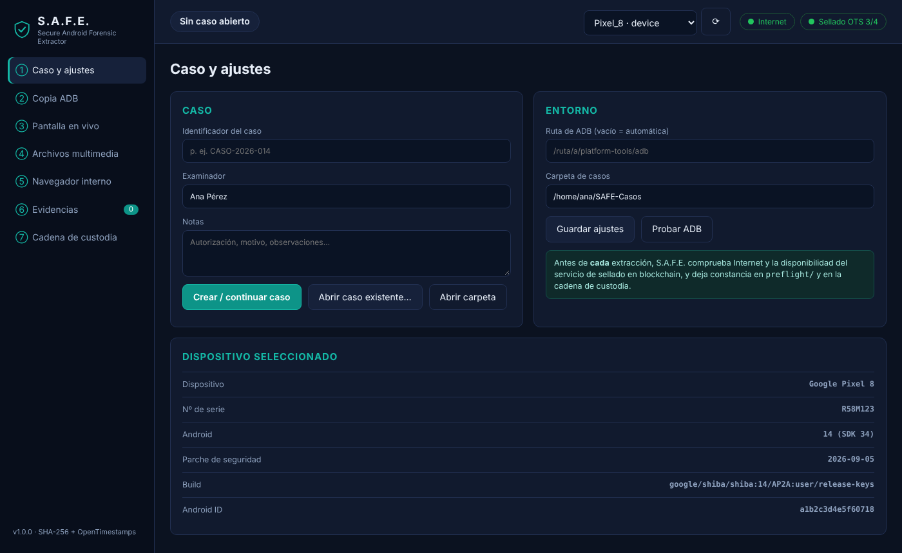
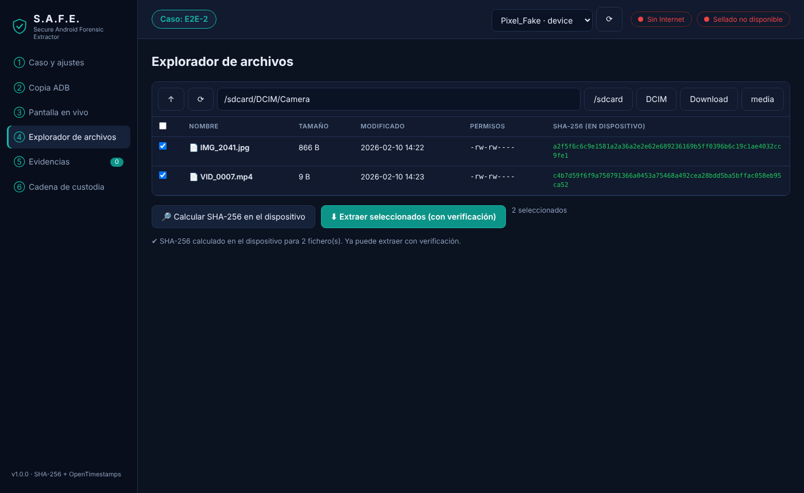
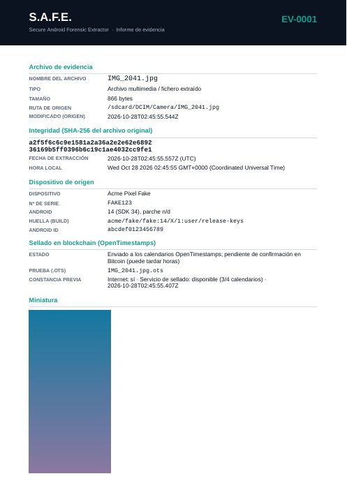

# S.A.F.E. — Secure Android Forensic Extractor

Herramienta de escritorio (Node.js + Electron) para la **adquisición forense de dispositivos Android**
con integridad verificable: cada evidencia recibe un **hash SHA-256**, un **sello de tiempo en la
blockchain de Bitcoin (OpenTimestamps)** y un **informe PDF comprimido**.



## Funciones

| Función | Descripción |
|---|---|
| **Copia de seguridad ADB** | `adb backup` (APK, almacenamiento compartido, OBB, apps del sistema) con progreso y cancelación. |
| **Pantalla en vivo interactiva** | Flujo H.264 directo del dispositivo (scrcpy-server), **sin recodificar**, a hasta 60 fps y baja latencia. Se puede **tocar, deslizar, escribir y usar Atrás/Inicio/Recientes** desde el ratón y el teclado. |
| **Dos motores de captura** | **scrcpy** (interactivo; sube un servidor temporal al teléfono) o **ADB nativo** (`screenrecord` → PC: **no sube nada al teléfono**, solo observar). En ambos el vídeo se guarda **en el PC**, nunca en el almacenamiento del dispositivo. |
| **Grabación en un solo archivo** | Un único `.h264` continuo (sin el límite de 3 min de `screenrecord`), con hash, sello e informe; copia `.mp4` derivada si hay `ffmpeg`. |
| **Explorador de archivos del teléfono** | Navega el sistema de archivos por ADB, marca ficheros/carpetas y **calcula su SHA-256 en el propio dispositivo antes de extraer**. Al extraer se recalcula y se **compara**; si no coincide se reintenta y queda constancia. |
| **Verificar sello** | Por evidencia: comprueba que el hash del archivo = registro = `.sha256` = hash **dentro del `.ots`**, y consulta su estado en Bitcoin. |
| **App en primer plano** | Se obtiene con `adb shell dumpsys window` (`mCurrentFocus`, con `mFocusedApp` de respaldo) y se incluye en el informe; durante la grabación se registra una cronología. |
| **Verificación previa obligatoria** | Antes de **cada** extracción se comprueba Internet y la disponibilidad del servicio de sellado, y se deja constancia (`preflight/*.json` + cadena de custodia). |
| **Finalizar caso** | Al terminar: verifica la integridad de todas las evidencias y de la custodia, genera un manifiesto, **comprime el caso completo en un ZIP**, calcula y sella su SHA-256 y hace una **validación final releyendo el ZIP** (cada archivo = manifiesto = hash de su evidencia). |
| **Cadena de custodia** | Registro `custody.log.jsonl` encadenado por hash (detecta manipulaciones). |



### Comportamiento sin conexión
Si no hay Internet (o el servicio OpenTimestamps no responde) S.A.F.E. avisa: *la extracción es viable,
pero se recomienda estar conectado para validar la integridad en blockchain*. Si el usuario continúa,
la evidencia se hashea y se informa igualmente, queda marcada **«Sin sellar»** y puede sellarse después
desde **Evidencias → Sellar / actualizar pruebas OTS** (el hash ya está fijado, por lo que el sello
posterior sigue probando el contenido, aunque con la fecha del sellado).

## Qué se genera por cada evidencia

```
SAFE-Casos/<CASO>/
├── case.json                  datos del caso
├── custody.log.jsonl          cadena de custodia (hash encadenado)
├── evidence.json              índice de evidencias
├── preflight/                 constancias de la verificación previa
├── MANIFEST.json / .sha256    (al finalizar) hash de cada archivo del caso
└── evidence/EV-0001/
    ├── IMG_2041.jpg           archivo ORIGINAL (nombre intacto, solo lectura)
    ├── IMG_2041.jpg.sha256    SHA-256 del original
    ├── IMG_2041.jpg.ots       prueba OpenTimestamps
    ├── miniatura.jpg          miniatura (capturas e imágenes)
    ├── informe_EV-0001.pdf    informe PDF comprimido
    └── paquete_EV-0001.zip    ZIP (informe + hash + .ots)
```

Al finalizar se crea junto a la carpeta del caso: `CASO_FINAL_<fecha>.zip`, `.zip.sha256`, `.zip.ots` y `.zip.verificacion.json`.

El **informe PDF** incluye: nombre del archivo (destacado), tipo, tamaño, ruta de origen, **SHA-256**,
**fecha de extracción** (UTC y local), **dispositivo de origen** (fabricante, modelo, nº de serie,
Android, build, Android ID), app en primer plano, estado del sellado, constancia de la verificación
previa y **miniatura** de la captura.



## Inicio rápido

```bash
git clone https://github.com/custodydev/safe.git
cd safe
npm install
npm start
```

Necesita [ADB (Android platform-tools)](https://developer.android.com/tools/releases/platform-tools).
Instrucciones completas: **[docs/INSTALACION.md](docs/INSTALACION.md)** ·
Manual de uso: **[docs/GUIA_DE_USO.md](docs/GUIA_DE_USO.md)**.

## Arquitectura

```
main.js            proceso principal Electron (IPC, puerta de verificación previa)
preload.js         puente seguro (contextIsolation)
renderer/          interfaz (HTML/CSS/JS, decodificador H.264 en vivo)
src/core/
  adb.js           envoltorio de ADB (dispositivos, info, foco, screencap, backup, ls/find/stat/sha256sum, pull)
  scrcpy.js        cliente del protocolo scrcpy (vídeo H.264 en vivo + inyección de entrada)
  net.js           comprobación de Internet y calendarios OpenTimestamps
  preflight.js     verificación previa + constancia
  ots.js           sellado / actualización / verificación con la librería `opentimestamps`
  finalize.js      cierre: manifiesto, ZIP completo, sello y validación final
  evidence.js      hash → sello → miniatura → PDF → ZIP → custodia
  report.js        informe PDF (pdfkit, comprimido) y paquete ZIP
  casestore.js     carpeta de caso y cadena de custodia
  acquire.js       adquisiciones (captura, backup, sesión en vivo, grabación, explorador/extracción verificada)
vendor/            scrcpy-server v3.3.3 (Apache-2.0, SHA-256 fijado)
test/              pruebas automáticas con un ADB simulado
```

Pruebas: `npm test`.

## Limitaciones conocidas (léalas antes de un peritaje)

- **`adb backup` está en desuso**: Android 12+ lo limita (las apps que lo excluyen no se copian) y
  exige confirmar en el dispositivo. Es una adquisición **lógica**, no un volcado físico.
- **Modo ADB nativo:** `screenrecord` limita cada ejecución a 180 s; S.A.F.E. lo relanza y encadena todo en **el mismo archivo** (hueco ≈ 1 s por reinicio, registrado en el informe con su hora). No admite interacción. Al iniciar la grabación se reinicia `screenrecord` una vez para obtener un fotograma clave inmediato.
- **Huella en el dispositivo (motor scrcpy):** scrcpy sube `scrcpy-server.jar` a `/data/local/tmp/` y lo borra al cerrar
  (`cleanup=true`). S.A.F.E. verifica su SHA-256 antes de subirlo y lo registra en la custodia. Si el protocolo de su
  procedimiento no admite ni ese rastro, use solo la copia ADB y el explorador.
- **Interacción:** tocar la pantalla **cambia el estado del dispositivo**. El nº de acciones queda en la custodia; desmarque
  «Permitir interacción» para una observación sin contacto.
- La grabación es H.264 crudo con tasa de fotogramas variable (solo se emiten fotogramas cuando la pantalla cambia). La copia
  `.mp4` usa la tasa media; el original es el `.h264`. Contenido protegido (DRM/`FLAG_SECURE`) se graba en negro.
- El SHA-256 «en dispositivo» usa `sha256sum` del propio Android (Android 6+); lee solo rutas accesibles sin root.
- Un sello OpenTimestamps nuevo es **«pendiente»** hasta que el calendario lo ancla en Bitcoin
  (normalmente horas). Use *Sellar / actualizar* más tarde para completarlo.
- El sellado prueba que el hash **existía** en esa fecha; no acredita por sí solo la autoría ni la legalidad de la obtención.
- Verificación real contra los calendarios públicos no se ha podido probar en el entorno de desarrollo (sin acceso); el flujo se valida con un calendario simulado.

## Uso legal y ético
Utilice S.A.F.E. únicamente sobre dispositivos que posea o para los que tenga **autorización expresa**
(consentimiento del titular u orden judicial). El examinador es responsable del cumplimiento de la
normativa aplicable (p. ej. protección de datos) y de documentar la cadena de custodia.

## Licencia
MIT — ver [LICENSE](LICENSE).
